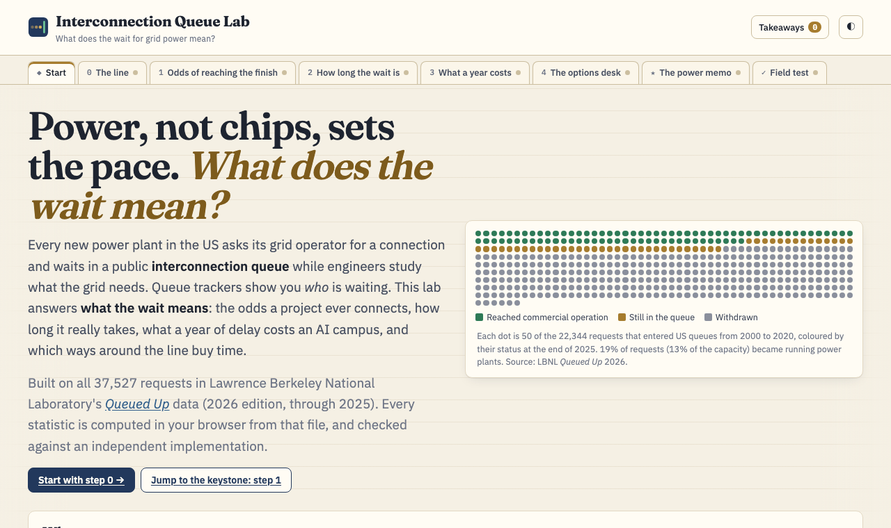

# Interconnection Queue Lab

**What does the wait for grid power mean?** A hands-on lab built on all 37,527 requests in Lawrence Berkeley National Laboratory's *Queued Up* data. It covers the odds a power project ever connects, counted correctly when most recent requests haven't finished; how long the wait really is, as a distribution; what a year of delay costs a 250 MW AI campus; and which ways around the line buy time.

**Play it: https://bakulbadwal.github.io/interconnection-queue-lab/**



Power, not chips, now sets the pace of AI buildout. Every new US power plant must ask its grid operator for a connection, then wait in a public **interconnection queue** while engineers study what the grid needs. Most requests are withdrawn, and the ones that get built are taking longer. Queue trackers show *which* projects are waiting. This lab answers **what the wait means**, in numbers you can defend.

The news hook: on Oct 6, 2026, Google signed a 20-year deal for 890 MW of **uprates** at 11 existing Constellation reactors in PJM ([POWER](https://www.powermag.com/google-deal-backs-890-mw-of-constellation-nuclear-uprates-at-11-pjm-reactors/)). That buys new megawatts behind a grid connection that already exists. Step 4 shows why that's worth so much.

## What's inside

| Step | You play with | What clicks |
|---|---|---|
| **0 · The line** | Every request since 2000, by region and outcome, by MW or by count | Of capacity that asked to connect 2000–2020, **13%** was running by end-2025 and **75%** was withdrawn (LBNL's headline, reproduced). These are *generator* queues; a data center's own load request is a separate line |
| **1 · Odds of reaching the finish** ★ | Region × technology × size × entry years; three ways to count | The naive share understates (unfinished ≠ failed). Kaplan–Meier that ignores withdrawals overstates wildly (withdrawn can't finish). For PJM requests since 2010: naive **11%**, KM **69%**, competing risks (Aalen–Johansen) **18%** within 10 years |
| **2 · How long the wait is** | Request→COD distribution for built projects; "already waited N years" landmark odds | In CAISO, MISO, PJM and SPP, the median wait rose from **3.6** years (built 2015–2019) to **5.7** (2021–2025), and the P90 from 7.5 to **8.9**. Survivors' odds rise (3-year COD odds **3%** at entry → **26%** at six years), but most are still waiting |
| **3 · What a year costs** | A 250 MW campus, Compute Deal Desk's price of a megawatt-year, discounting, an "idle GPUs" toggle, the measured waits of big PJM gas plants | One year late ≈ **$613M** at teaching prices, **$1.49B** if the GPUs are already bought. The null case (power on the ready date) is $0 |
| **4 · The options desk** | Queue a new build (measured), PJM's expedited track, an uprate (Google–Constellation), a restart (Crane), behind-the-meter gas, flexible load | The scarce asset is the **interconnection right**, not the generator. Even Crane's restart ran into PJM upgrades until 2031 |
| **★ The power memo** | Split 250 MW across paths; exact odds of ≥200 MW by end-2029; a six-sentence memo drafted from your plan | All in the queue: **2%**. A reference mix (uprate + behind-the-meter gas + flexible load): **26%** |
| **✓ Field test** | Eight questions answered by operating the widgets | Proof it stuck |

Each step has a predict-then-reveal question, a "say it out loud" line, a model card (the estimator, what's measured vs modeled, the Python twin), and a running, printable list of **takeaways**.

## What's measured and what's modeled

- **Measured** (tag: *measured*): every share, odds curve, wait distribution and landmark probability, computed in your browser at run time from [`data/queue.json`](data/queue.json), a cleaned extract of LBNL's file.
- **Sourced** (tag: *sourced*): deal terms, dates and equipment prices, cited where they appear and listed in [DATA.md](DATA.md).
- **Teaching values** (tag: *teaching value*): the value of a megawatt-year ($3.48M, Compute Deal Desk's shadow price at teaching prices), the discount rate, and the odds and most-likely times for paths with no public track record. **Quote the measured numbers and the mechanics, not the dollars.**

**Limits.** These are generator queues, not load queues. Timing statistics come from the four regions whose files date nearly every outcome (CAISO, MISO, PJM, SPP; 14,951 requests entered 2010–2025). ERCOT can be counted but not timed. Details in [DATA.md](DATA.md).

## What already exists, and why this is different

| Tool | Offers | This lab adds |
|---|---|---|
| [interconnection.fyi](https://www.interconnection.fyi/) (GridTracker) | Daily tracker of 44k requests: map, filters, status | Odds, durations, delay cost, options |
| [GridStatus](https://docs.gridstatus.io/en/latest/interconnection_queues.html) app + `gridstatus` library | Queue browser; standardized ISO queue DataFrames | Statistics on outcomes and timing |
| [LBNL *Queued Up*](https://emp.lbl.gov/queues) + its [durations dashboard](https://emp.lbl.gov/transmission-interconnection-queue-durations-and-outcomes) | The authoritative cohort completion shares (2000–2020) and median durations, one dimension at a time | Censoring-aware odds that use recent requests too; any region × technology × size × era slice; P90s; conditional "already waited" odds; dollars; options |
| [Paces](https://www.datacenterdynamics.com/en/company/paces/) | Commercial siting with power-flow studies | A free teaching lab on the queue statistics themselves |

## Checks

`make check` is the acceptance gate (916 checks plus 270 cross-checks at the last run):

- every estimator in `js/stats.js` and `js/econ.js` is re-implemented in pure-stdlib Python ([`models/`](models/)), and 736 values must agree to 1e-9;
- the survival estimators are cross-checked against **statsmodels** (`CumIncidenceRight`, `SurvfuncRight`), an implementation this repo didn't write: 270 values to 1e-9;
- null cases and identities: no delay ⇒ $0; S + CIF<sub>COD</sub> + CIF<sub>withdrawn</sub> = 1; KM = Aalen–Johansen with no competing events; Aalen–Johansen = the naive share with no censoring; a certain, on-time portfolio ⇒ P = 1;
- LBNL's published headline (13% / 75% / 19%) is reproduced from the snapshot;
- every number the copy quotes is computed in [`js/numbers.js`](js/numbers.js) and written to [`tests/numbers.json`](tests/numbers.json). The check fails if a step file hard-codes a percentage or dollar figure that isn't traced there or to the cited-sources list.

```bash
make check      # Node + Python (statsmodels via uv)
make serve      # http://localhost:8831 (ES modules need http://, not file://)
make smoke      # load every route in headless Chrome, with the server running
make data       # re-download LBNL's file (SHA-256 checked) and rebuild data/queue.json
```

## Files

| Path | Role |
|---|---|
| `data/fetch_clean.py` | Download, hash check, clean, write `queue.json` and `SNAPSHOT.md` |
| `data/options.json` | Campus inputs and the options desk's anchors, tagged measured / sourced / teaching |
| `js/stats.js` | Outcome shares, Kaplan–Meier, Aalen–Johansen, landmark odds, quantiles |
| `js/econ.js` | Delay cost, triangular time-to-power ranges, the exact portfolio distribution |
| `js/numbers.js` | Every number the prose quotes, computed once |
| `js/steps/*.js` | One module per step |
| `models/` | The Python twins and `run_checks.py` |
| `tests/` | `check.mjs`, `check_statsmodels.py`, `battery.json`, `numbers.json` |

## Siblings

- [Hyperscale Ledger](https://github.com/bakulbadwal/hyperscale-ledger): the campus (audited GPU specs, rack power, the 250 MW scenario).
- [Compute Deal Desk](https://github.com/bakulbadwal/compute-deal-desk): what a megawatt is worth (the shadow price this lab multiplies by time).
- Interconnection Queue Lab: how long until the megawatt arrives, how likely it is, and what the wait costs.

Built by [Bakul Badwal](https://github.com/bakulbadwal) (UVA Darden MBA '27) with Claude Code.

## License

Code: MIT (see `LICENSE`). Data: `data/queue.json` is adapted from the *Queued Up* 2026 data file by Lawrence Berkeley National Laboratory and GridTracker, licensed [CC BY 4.0](https://creativecommons.org/licenses/by/4.0/). The changes are listed in [DATA.md](DATA.md).
